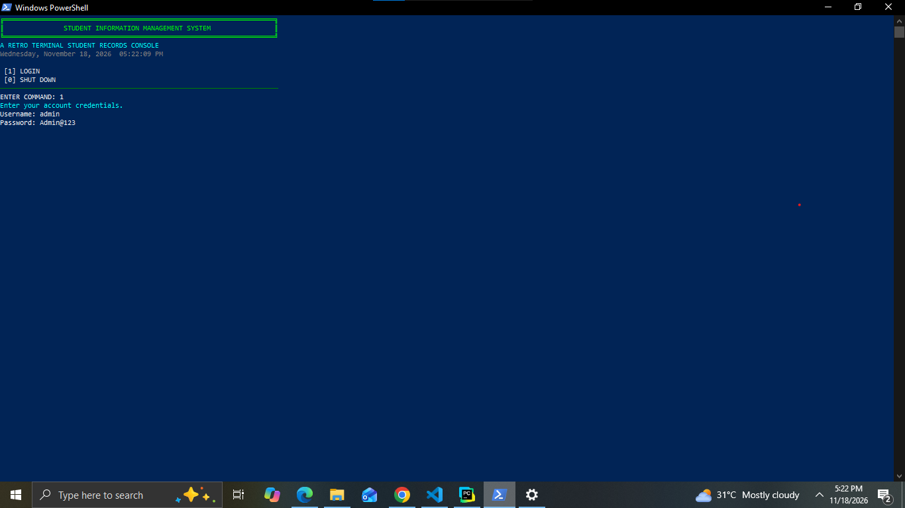
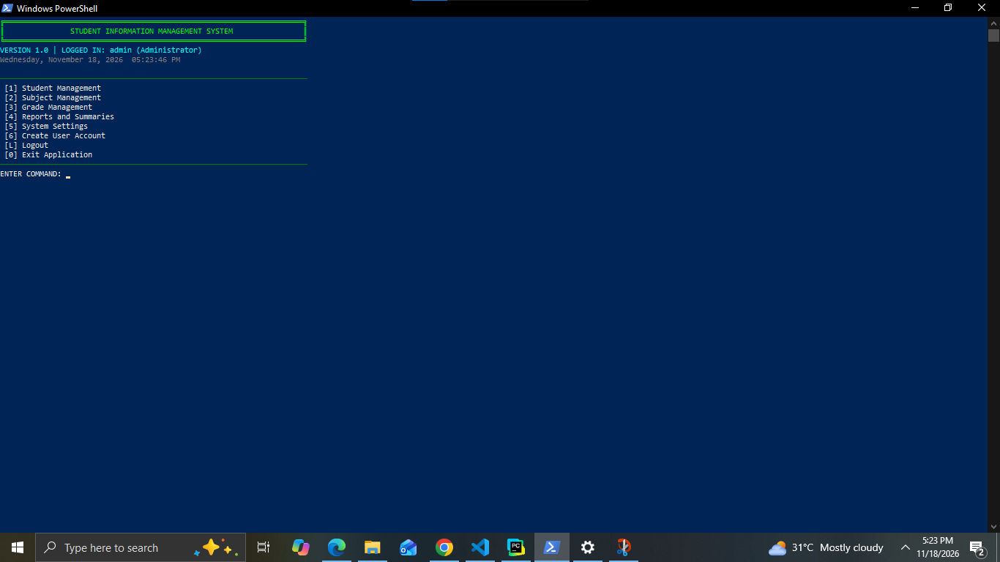
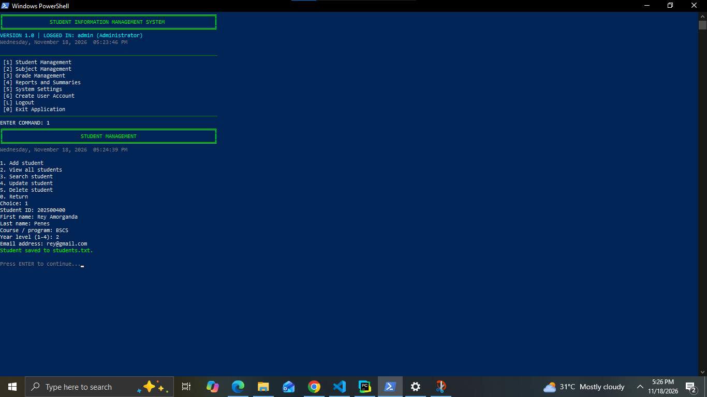
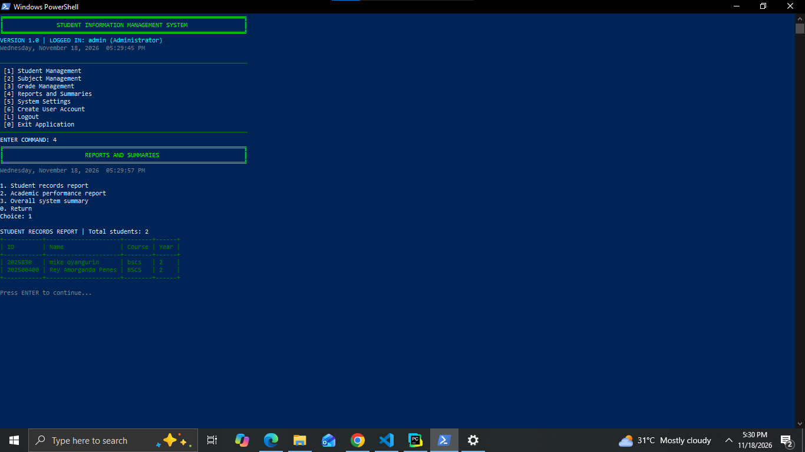
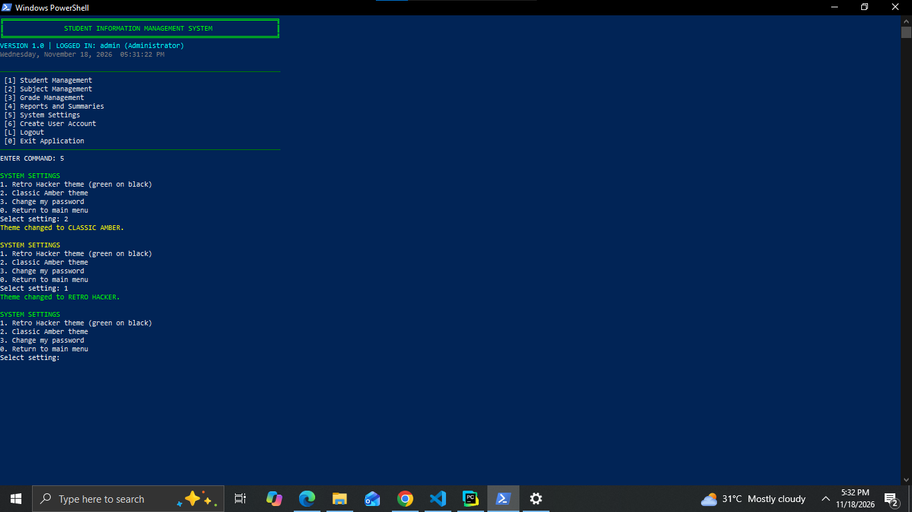

# Student Information Management System (SIMS)

**Python Final Laboratory Project — Terminal-Based Management System with File Handling**

## 1. Project description
SIMS is a menu-driven, terminal-based application for maintaining student profiles, subjects, and grades. It uses plain-text `.txt` files for persistent storage and provides role-based login, reports, input validation, and two terminal color themes.

## 2. Features
- Administrator and Staff login roles
- Passwords stored as salted PBKDF2-HMAC-SHA256 hashes (not plain text)
- Student add, view, search, update, and delete
- Subject add, view, and search
- Grade encoding, updating, viewing, and average calculation
- Student records report, academic performance report, and system summary
- Retro Hacker (green) and Classic Amber themes
- Password change and administrator account creation
- Data remains saved after closing and reopening the program

## 3. Requirements
- Python 3.9 or later
- Terminal / command prompt
- No third-party packages are required

## 4. Installation and running
1. Extract the project ZIP file.
2. Open a terminal in the `Student_Information_Management_System` folder.
3. Run:

   ```bash
   python main.py
   ```

   On some systems, use `python3 main.py`.

The program automatically creates missing data files in the `data` folder.

## 5. Demo accounts
The first run creates these sample accounts only when `data/users.txt` is empty:

| Role | Username | Initial password |
|---|---|---|
| Administrator | `admin` | `Admin@123` |
| Staff | `staff` | `Staff@123` |

**Security reminder:** These are demonstration credentials, not production credentials. Log in and change the passwords before using real information. Do not upload real passwords or sensitive personal information to a public repository. The `users.txt` file contains salted password hashes, not readable passwords.

## 6. Text database format
Files are stored in the `data/` directory. Fields are separated by the pipe character (`|`).

- `users.txt`: username, role, salt, password hash
- `students.txt`: student ID, first name, last name, course, year level, email
- `subjects.txt`: subject code, subject name, units
- `grades.txt`: student ID, subject code, grade, semester

The application reads records when a menu action is used and writes changes back to the text files. The files are plain text and can be inspected with a text editor. Avoid typing the `|` character into field values because it is the field separator.

## 7. Role permissions
- **Administrator:** all student and subject operations, grade operations, reports, settings, and user account creation.
- **Staff:** view and search students and subjects, encode/view grades, calculate averages, view reports, and change personal password/theme. Staff cannot add/update/delete student records or add subjects.

## 8. Reports
1. Student Records Report — lists registered students and total count.
2. Academic Performance Report — calculates each student's average from recorded grade entries and labels averages of 75 or higher as PASSED.
3. Overall System Summary — counts students, subjects, and grade entries and displays the overall recorded grade average.

The passing threshold of 75 is a sample rule for this project and can be adjusted to match your instructor's grading policy.

## 9. Suggested demonstration sequence
1. Start `main.py` and show the login screen.
2. Log in as Administrator and show the dashboard/date/time.
3. Add a student and show the saved entry in `data/students.txt`.
4. Add a subject and encode a grade for the student.
5. Search for the student and display the student list.
6. Open the reports menu and demonstrate the student report, academic report, and system summary.
7. Open Settings and switch between both color themes.
8. Change the administrator password.
9. Log out, log in as Staff, and demonstrate role restrictions.
10. Close and reopen the program to prove that records persist.

## 10. Screenshots and video
Save your own screenshots in the `screenshots/` folder:
- Login screen
- Dashboard
- Student/subject/grade file operations
- Reports
- Theme customization

Record your demonstration, explain the functions and TXT file handling, then upload it to the Facebook and YouTube destinations required by your instructor. Submit the accessible links through your LMS.nn









## 11. GitHub submission checklist
- Upload all `.py` files, `data/` sample files, README, requirements, and screenshots.
- Do not publish personal student information or real credentials.
- Invite `natzjun2@gmail.com` as a repository collaborator if your instructor requires it.
- Verify that the repository and video links are accessible to your instructor.

## 12. Limitations / notes
- This is an educational local terminal project, not a production student-record platform.
- The text files do not provide encryption at rest or multi-user file locking.
- ANSI colors work in most modern terminals. If colors do not display, use a terminal with ANSI escape support.

